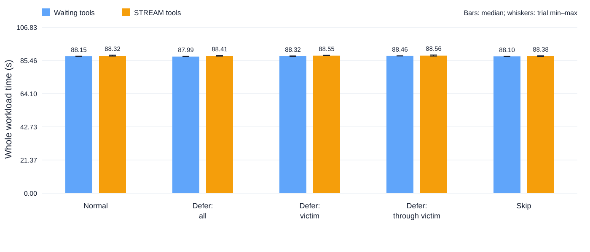
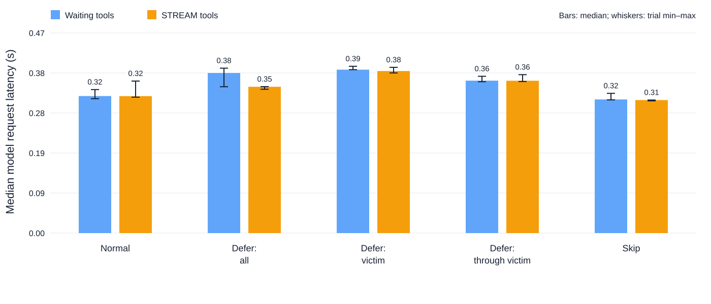
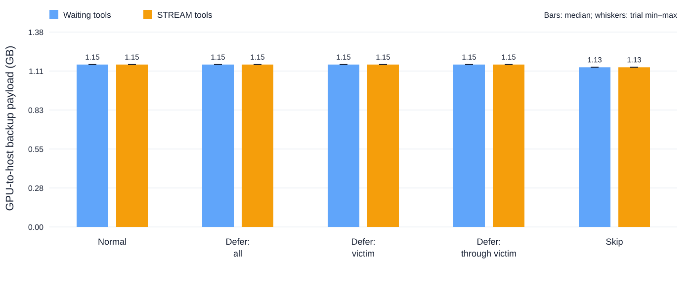

# Audited policy study — November 9, 2026

**13 of 15 combinations are complete: 78 validated measured trials.** The two
missing combinations are write-back/skip and write-back/defer-victim. Do not
read the old `running` status files as evidence that those experiments finished.
The November 5 allocation has ended. Larger-workload plans exist, but there are
no accepted scale-up measurements in this historical report.

[Full tables](TABLES.md), [machine-readable summary](summary.csv),
[raw-file identities and missing/rejected attempts](provenance.json), and
[reproduction manual](../../trace-replay/REPRODUCE.md).

The 15 combinations are three base policies (write-through, selective
write-through, write-back), each with normal, skip, defer/all, defer/victim or
defer/through-victim. Queue selection applies only to defer. Every accepted
combination has three waiting-tool trials and three STREAM trials, excluding
warmup. Missing combinations remain N/A in the generated figures.

## What the completed measurements tell us

Whole-workload time changes are small in this diagnostic: for write-through
with STREAM tools, normal takes 88.32 s, skip 88.38 s, and the defer variants
88.41–88.56 s. These differences do not establish a whole-workload speedup.
Long tool waits dominate the total, so inspect model-request latency separately.

| Write-through / STREAM | Whole-time change vs normal | Request-latency change | STREAM-rate change |
|---|---:|---:|---:|
| Skip | +0.07% | −2.86% | −0.66% |
| Defer/all | +0.10% | +6.84% | −11.28% |
| Defer/victim | +0.26% | +18.34% | −7.39% |
| Defer/through-victim | +0.28% | +11.25% | +3.79% |

These are comparisons of three-trial medians. Min–max whiskers describe the
sample; they are not confidence intervals. Configuration blocks ran at
different times on a shared node, so hardware drift can affect the results.
The mixed STREAM-rate changes give no consistent evidence of a bandwidth win.

Victim selection actually activated in write-through (median three selections
per trial), reducing pressure overrides from roughly 22–23 for defer/all to 12
for the victim strategies. All three still copy about 1.152 GB per trial. Thus
selection changes how progress is made, without reducing total copy volume or
showing a whole-workload benefit here. Selective write-through recorded zero
partial selections: those rows cannot establish a victim-selection advantage.

Skipping copies has a cache tradeoff. Write-through/skip reduces measured input
reuse from 78.8% to 47.4%, while selective write-through/skip reduces reuse from
78.7% to 42.9%. Selective skip copies 0.435 GB instead of 1.117 GB. Lower copy
volume therefore does not mean the same useful cache was preserved. Likewise,
less host-to-GPU restoration can reflect lost reusable host cache rather than
an efficiency improvement. Examine post-tool costs as well as tool-window traffic.

Write-back has no eager optional-copy queue in this implementation. Its accepted
normal/defer variants have matching transfer volumes and nearly identical
whole times. It serves as a negative control; the two unfinished write-back
combinations still need measurement rather than assumed equivalence.

## Why scale up

About 1.15 GB D2H over 88 s averages only 13 MB/s, though bursts can matter more
than that average. A larger payload experiment is warranted to test whether the
observed small effects persist. The prepared `token4x` plan keeps session IDs,
tools, tool timing and output lengths fixed and raises input/prefix lengths
from 8% to 32% of trace counts. GPU pool/reserve/pending capacity also grow 4×;
host cache remains 4 GB. This tests a larger serving regime and can change cache
capacity pressure and prefill admission as well as interference. It cannot
isolate physical DMA contention by itself.

## Hardware, workload and provenance

- Slurm job 6824964; host atl1-1-02-003-31-0; 16 physical CPU cores, 64 GiB RAM.
- Physical Blackwell RTX PRO 6000: 97887 MiB; CUDA device **MIG 2g.48gb**,
  `MIG-e7d8371e-b155-540c-9a71-d3cad44c7fc9`.
- Server CPUs `4,8,9,11`; tool CPUs
  `17,18,19,20,21,34,35,36,44,45,46,47`; all GPU-local on NUMA 0.
- Four STREAM workers × three cores; buffers allocated, first-touched and warmed
  before measurement, with full validation and process cleanup afterwards.
- Qwen/Qwen3-0.6B; SGLang 0.5.21/controller commit `0c6af068ab`; Triton attention,
  PyTorch sampling, seed 6222, CUDA graphs disabled, static fraction 0.30.
- GPU KV pool 4096 tokens; reserve 2048; pending bound 4096; age bound 2 seconds;
  context limit 4096; host KV cache 4 GB.
- Four trace-derived sessions × four rounds, 12 tools, 20 requests including
  reuse tail, 8% tokens, output cap 32; original tool durations 2.418–72.709 s,
  tool scaling 1 with no cap, user wait cap 5 seconds.
- TraceLab v0.0.1 SHA256
  `9d265eae69a31cae203848bea936f018148eed7ca8bf56050c5abe96da0b4e6b`.

The public trace has no original prompts/tool commands. Tokens and STREAM tool
work are synthetic. Only 27 sessions passed the timing/context/overlap filter.
This is a small-model cache-pressure diagnostic, not representative production
TraceLab or full-GPU performance. Scheduler submission/completion events do not
measure exact physical DMA overlap or TTFT.

Raw JSON, journals, source snapshots and the failed timing attempt remain under
`scripts/results/pace-6824964-rtx_pro_6000_blackwell-numa0-t12/`. The accepted roots
are `matrix/` and `matrix-continuation/`; the audit excludes the failed original
write-through/skip STREAM attempt. Raw artifacts are retained locally and are
not included in Git; `provenance.json` records their filenames and content/source
identities. Do not combine fresh-allocation rows with these old rows as though
placement and source versions were unchanged.

## Example figures

Regenerate every figure from accepted raw JSON with the commands in the manual.
These SVG examples use medians with min–max whiskers.

